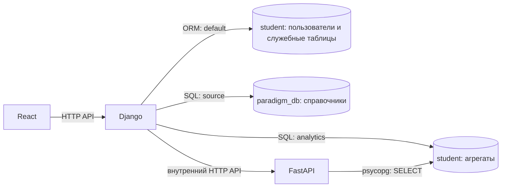

# Базы данных и таблицы Smart Energy

> Дополнение для адаптера-сервиса: см. раздел 14. Переход потребителей на сохранённый `energy_kwh` включается отдельно через `ENERGY_USE_STORED_ENERGY=1`; по умолчанию сохранено прежнее поведение.

## 1. Область описания

Документ описывает взаимодействие приложения с базами данных по текущему коду Django, FastAPI, миграциям и конфигурации Docker Compose.

Дополнительно учтены предоставленный `agg_taables.sql` и уточнение владельца проекта: исходные показания находятся в `paradigm_db.public.electricity_sensor_readings`, а `student.student_schema.electricity_sensor_readings` — их скопированная таблица. Для перехода агрегаций на исходник подготовлены [SQL-скрипты и порядок проверки производительности](sql/README.md); их наличие не означает, что они уже установлены в рабочей БД.

Основная СУБД — **PostgreSQL**. В стандартной конфигурации приложение использует **две логические базы данных**:

- **`paradigm_db`** — справочники счётчиков, помещений, зданий, питающих линий и подразделений.
- **`student`** — часовые и суточные агрегаты электрических измерений, пользователи и служебные данные Django.

Точные имена баз, адрес сервера и имена таблиц агрегатов можно изменить переменными окружения. Две базы могут находиться на одном сервере PostgreSQL; отдельные настройки позволяют разместить их на разных серверах.

Описание составлено **без подключения к работающей БД**. Для внешних справочников перечислены поля, которые использует код: в самой БД могут существовать дополнительные столбцы. `agg_taables.sql` определяет агрегаты как обычные таблицы с составным первичным ключом `(bucket_start, sensor_name)`. Их фактическое состояние, а также структура и ограничения остальных объектов на рабочем сервере по системному каталогу не проверены.

## 2. Какие компоненты обращаются к БД

| Компонент | Способ доступа | Что читает | Что записывает |
| --- | --- | --- | --- |
| React/Vite | HTTP-запросы к Django | Ответы API: профиль, фильтры, графики, связи оборудования, результаты анализа | Через API передаёт данные регистрации и запросы авторизации; прямого подключения к БД нет |
| Django REST API | Django ORM через `default` | Пользователей, права, сессии, сведения о JWT | Пользователей, записи refresh-токенов и их отзыва; служебные данные при работе админки и миграциях |
| Django REST API | SQL через `source` | Справочники из `paradigm_db` | Обработчики API справочники не изменяют |
| Django REST API | SQL через `analytics` | Часовые и суточные агрегаты из `student` | Обработчики API агрегаты не изменяют |
| FastAPI | SQL через `psycopg` | Часовые агрегаты из `student` | Расчёты возвращает в ответе; результатов анализа в БД не сохраняет |



`default` и `analytics` — разные имена подключений Django, хотя по умолчанию они ведут в одну базу `student`.

## 3. Подключения, базы и схемы

### 3.1. Подключения Django

| Псевдоним подключения | База по умолчанию | Параметры выбора базы | Назначение |
| --- | --- | --- | --- |
| `default` | `student` | `DJANGO_POSTGRES_DB` | ORM, пользователи, авторизация, админка, миграции |
| `source` | `paradigm_db` | `SOURCE_POSTGRES_DB`; предусмотрены резервные значения из `POSTGRES_DB` / `DASHBOARD_POSTGRES_DB` | Справочники и структура объектов |
| `analytics` | `student` | `ENERGY_AGG_POSTGRES_DB` | Готовые агрегаты измерений для дашборда |

Основные общие параметры: `POSTGRES_HOST`, `POSTGRES_PORT`, `POSTGRES_USER`, `POSTGRES_PASSWORD`. Дополнительно можно задать собственные параметры `SOURCE_POSTGRES_*`, `ENERGY_AGG_POSTGRES_*`, а для учётных данных `default` — `DJANGO_POSTGRES_USER` и `DJANGO_POSTGRES_PASSWORD`.

Для подключения `default` по умолчанию задано:

```text
search_path = student_schema, public
```

Этим управляет `DJANGO_POSTGRES_OPTIONS`. Имена ORM-таблиц не содержат явного указания схемы. При обычной конфигурации, наличии схемы и необходимых прав миграции создают таблицы в `student_schema`; фактическое размещение существующих таблиц зависит от состояния БД и `search_path` на момент создания.

Справочники в SQL указаны со схемами `public` и `structure`, а таблицы агрегатов — со схемой `student_schema`. **База данных и схема — разные уровни организации**: например, `student` — база, `student_schema` — схема внутри неё.

### 3.2. Подключение FastAPI

FastAPI создаёт прямое подключение `psycopg` к PostgreSQL. Основные параметры:

| Параметр | Значение по умолчанию / назначение |
| --- | --- |
| `ANALYTICS_POSTGRES_DB` | `student`; резервное имя настройки — `ENERGY_AGG_POSTGRES_DB` |
| `ANALYTICS_POSTGRES_HOST` | `127.0.0.1`; резервные настройки — `ENERGY_AGG_POSTGRES_HOST`, `POSTGRES_HOST` |
| `ANALYTICS_POSTGRES_PORT` | `15432`; резервные настройки — `ENERGY_AGG_POSTGRES_PORT`, `POSTGRES_PORT` |
| `ANALYTICS_POSTGRES_USER`, `ANALYTICS_POSTGRES_PASSWORD` | Учётные данные; резервные настройки — `ENERGY_AGG_POSTGRES_USER`, `ENERGY_AGG_POSTGRES_PASSWORD` |
| `ANALYTICS_HOURLY_TABLE` | `student_schema.electricity_sensor_readings_hourly`; резервная настройка — `ENERGY_HOURLY_TABLE` |
| `ANALYTICS_TIMEZONE` | `Europe/Moscow`; используется для границ периодов анализа |

Чтобы Django и FastAPI анализировали одинаковые данные, их настройки часового агрегата и базы должны указывать на один источник.

### 3.3. Доступ при локальном запуске

В текущем `docker-compose.yml` **нет контейнера PostgreSQL**: сервисы подключаются к внешнему серверу. Согласно инструкции запуска, используется SSH-туннель:

```text
приложение на компьютере → 127.0.0.1:15432 → SSH-туннель → PostgreSQL:5432
контейнеры → host.docker.internal:15432 → тот же SSH-туннель
```

Compose по умолчанию подставляет `host.docker.internal` и порт `15432`. В самих настройках Django резервный порт при запуске в Docker — `5432`, но Compose переопределяет его на `15432`. Вне Docker резервный адрес Django — `127.0.0.1:15432`.

Пароли и токены в документ не включены. Фактические параметры следует смотреть в окружении запуска; значения из примеров могут быть переопределены.

## 4. Общий перечень предметных таблиц

| База | Таблица / объект | Назначение | Использование в текущих API |
| --- | --- | --- | --- |
| `paradigm_db` | `public.sensor_directory` | Реестр счётчиков и их мест установки | Чтение Django |
| `paradigm_db` | `structure.room` | Помещения, этажи, привязки к зданиям и подразделениям | Чтение Django |
| `paradigm_db` | `structure.building` | Справочник зданий | Чтение Django |
| `paradigm_db` | `structure.feeder` | Питающие линии — фидеры | Чтение Django |
| `paradigm_db` | `structure.room_feeder` | Связи питающих линий с обслуживаемыми помещениями | Чтение Django |
| `paradigm_db` | `structure.org_structure` | Организационные подразделения | Чтение Django |
| `student` | `student_schema.electricity_sensor_readings_hourly` | Измерения, агрегированные по часам | Чтение Django и FastAPI |
| `student` | `student_schema.electricity_sensor_readings_daily` | Измерения, агрегированные по суткам | Чтение Django |
| `paradigm_db` | `public.electricity_sensor_readings` | Оригинальные сырые электрические измерения | Источник подготовленного FDW-пересчёта; API дашборда напрямую не читает |
| `student` | `student_schema.electricity_sensor_readings` | Скопированные исходные измерения | Прежний источник агрегаций по уточнению владельца; новый FDW-пересчёт копию не использует |

## 5. Справочники в базе `paradigm_db`

### 5.1. `public.sensor_directory` — реестр счётчиков

**Для чего нужна:** определяет, какие счётчики доступны приложению, как они называются и где установлены. С неё начинается построение списка устройств и связей с помещениями.

| Поле, используемое кодом | Содержимое и назначение |
| --- | --- |
| `id` | Идентификатор записи счётчика; возвращается в описании устройства как строка |
| `sensor_name` | Название счётчика; основной идентификатор для сопоставления со строками агрегатов |
| `roomid` | Ссылка на помещение установки: `structure.room.id` |

В ответах API `sensor_name` обычно называется **`data_name`**. Сопоставление со значениями потребления выполняется по имени, а не по `id`.

Из названия удаляется завершающий суффикс ` Smart Meter` с помощью `regexp_replace(..., '\s+Smart Meter$', '')`. Полученная строка используется для поиска `structure.feeder.feeder_name`. Например, имя `F1 Smart Meter` сопоставляется с фидером `F1`.

Таблица используется для фильтров, подписей графиков, карточки счётчика, списка счётчиков тепловой карты и поиска устройств по помещениям и подразделениям.

### 5.2. `structure.room` — помещения

**Для чего нужна:** описывает помещения и их положение в структуре объекта. Одна и та же таблица участвует в запросе в двух ролях: помещение установки счётчика и помещение, которое получает питание через его фидер.

| Поле | Содержимое и назначение |
| --- | --- |
| `id` | Идентификатор помещения, используемый при соединениях |
| `room_number` | Номер или обозначение помещения; в API — `room` либо место установки `power_location` |
| `floor_number` | Обозначение этажа; в API — `floor` |
| `buildingid` | Ссылка на `structure.building.id` |
| `room_description` | Описание или назначение помещения; используется в описании устройства и потребителя |
| `org_structureid` | Ссылка на `structure.org_structure.id` |

Место установки прибора **может отличаться от обслуживаемых помещений**. Фильтры по потребителям и распределение нагрузки строятся по помещениям, связанным с фидером через `room_feeder`.

### 5.3. `structure.building` — здания

**Для чего нужна:** позволяет вывести название здания для помещения и фильтровать счётчики по зданиям обслуживаемых помещений.

| Поле | Содержимое и назначение |
| --- | --- |
| `id` | Идентификатор здания |
| `building_name` | Название здания; в API — `building` |

Связь выполняется по `room.buildingid = building.id`. Здание определяется отдельно для места установки счётчика и для помещений потребителей.

### 5.4. `structure.feeder` — питающие линии

**Для чего нужна:** связывает счётчик с электрической линией, от которой питаются помещения.

| Поле | Содержимое и назначение |
| --- | --- |
| `id` | Идентификатор фидера; используется в `room_feeder.feederid` |
| `feeder_name` | Обозначение линии; сопоставляется с именем счётчика после удаления суффикса |
| `feeder_description` | Описание питающей линии; включается во внутренние результаты SQL |

В API присутствуют термины `breaker` и `breakers`, однако данные для них строятся из фидеров и связей с помещениями. Отдельная физическая таблица автоматических выключателей в текущих запросах не используется.

### 5.5. `structure.room_feeder` — связь помещений с фидерами

**Для чего нужна:** хранит, какие помещения обслуживает каждая питающая линия. Это связующая таблица, позволяющая представить отношения «многие ко многим» между помещениями и фидерами.

| Поле | Содержимое и назначение |
| --- | --- |
| `roomid` | Ссылка на `structure.room.id` |
| `feederid` | Ссылка на `structure.feeder.id` |

Через неё приложение получает список помещений потребителей, фильтрует счётчики по помещению, этажу и зданию, а также рассчитывает распределение потребления по помещениям.

Код использует только эти два столбца. Наличие собственного `id` или составного первичного ключа по репозиторию не установлено.

### 5.6. `structure.org_structure` — организационная структура

**Для чего нужна:** связывает помещение с организационным подразделением и предоставляет группировку потребителей.

| Поле | Содержимое и назначение |
| --- | --- |
| `id` | Идентификатор подразделения |
| `struc_name` | Название подразделения; в API используется как `consumer_class` |

Соединение: `room.org_structureid = org_structure.id`. Для отображаемого имени потребителя выбирается первое непустое значение: описание помещения, затем название подразделения, затем номер помещения.

### 5.7. Логические связи справочников и измерений

```text
sensor_directory.roomid ───────────────→ room.id              (место установки)
room.buildingid ───────────────────────→ building.id
room.org_structureid ──────────────────→ org_structure.id

sensor_directory.sensor_name
    └─ удалить суффикс " Smart Meter" → feeder.feeder_name
feeder.id ← room_feeder.feederid
room_feeder.roomid ────────────────────→ room.id              (потребитель)

sensor_directory.sensor_name ──────────→ hourly.sensor_name
sensor_directory.sensor_name ──────────→ daily.sensor_name
```

Это связи, выраженные в коде запросов, а не подтверждённый перечень ограничений `FOREIGN KEY`. Сопоставление справочников и агрегатов из разных баз выполняется приложением: Django сначала получает имена подходящих счётчиков из `source`, затем передаёт их в запросы к `analytics` или в FastAPI.

## 6. Агрегаты потребления в базе `student`

### 6.1. `student_schema.electricity_sensor_readings_hourly` — часовые агрегаты

**Для чего нужна:** основной источник числовых данных дашборда и статистического сравнения периодов. Код ожидает показатели счётчика за час.

Таблица задаётся параметром Django `ENERGY_HOURLY_TABLE` и параметром FastAPI `ANALYTICS_HOURLY_TABLE`.

| Поле, используемое кодом | Ожидаемое содержимое | Единица / роль |
| --- | --- | --- |
| `sensor_name` | Имя счётчика | Сопоставление со справочником и фильтрация |
| `bucket_start` | Начало часового интервала | Временная ось; сравнения с `timestamptz` |
| `points_count` | Число исходных измерений, вошедших в агрегат | Сумма исходных точек и вес при усреднении |
| `active_power_w_avg` | Средняя активная мощность за час | Вт |
| `active_power_w_max` | Максимальная активная мощность за час | Вт |
| `phase1_power_w_avg` | Средняя активная мощность фазы 1 | Вт |
| `phase2_power_w_avg` | Средняя активная мощность фазы 2 | Вт |
| `phase3_power_w_avg` | Средняя активная мощность фазы 3 | Вт |
| `reactive_power_var_avg` | Средняя реактивная мощность | вар |
| `apparent_power_va_avg` | Средняя полная мощность | В·А |
| `current_avg_a` | Средний ток | А |
| `voltage_avg_v` | Среднее напряжение | В |
| `frequency_hz_avg` | Средняя частота | Гц |
| `meter_temperature_avg` | Средняя температура прибора | Единица в коде БД явно не закреплена |
| `energy_kwh` | Сумма оценок энергии исходных минутных записей по DDL и формуле `agg_taables.sql` | кВт·ч; текущие запросы API это поле не читают |

Как применяется:

- Диапазон доступных дат — `MIN(bucket_start)` и `MAX(bucket_start)`.
- Сводные показатели — число счётчиков, количество исходных точек, энергия, средняя и максимальная суммарная часовая мощность, напряжение и частота.
- `current_power_kw` — суммарная **средняя мощность последнего доступного часа**, а не мгновенное измерение прибора.
- Рейтинг счётчиков — энергия, средняя мощность с весом `points_count` и максимум `active_power_w_max`.
- Часовые графики и графики тех показателей, которых нет в используемом наборе суточных данных.
- Распределение нагрузки по помещениям и тепловая карта потребления по дням недели.
- Статистика FastAPI — среднее, выборочная дисперсия и стандартное отклонение суммарной часовой мощности, число наблюдений, энергия и Z-тест.

В `agg_taables.sql` уникальность пары «счётчик + начало часа» задана составным первичным ключом. Наличие этого ограничения на рабочем сервере не проверено.

### 6.2. `student_schema.electricity_sensor_readings_daily` — суточные агрегаты

**Для чего нужна:** уменьшает объём обрабатываемых данных при построении дневных и недельных графиков. Код ожидает показатели счётчика за календарные сутки.

Таблица задаётся параметром `ENERGY_DAILY_TABLE`. FastAPI в текущей реализации её не использует.

| Поле, используемое кодом | Ожидаемое содержимое |
| --- | --- |
| `sensor_name` | Имя счётчика |
| `bucket_start` | Дата / начало суток; код приводит значение к `date` и `timestamp` |
| `points_count` | Число исходных измерений, используемое как вес |
| `active_power_w_avg` | Средняя активная мощность за сутки, Вт |
| `active_power_w_max` | Максимум часовых максимумов по `agg_taables.sql`, Вт; текущие суточные запросы API поле не читают |
| `reactive_power_var_avg` | Средняя реактивная мощность, вар |
| `apparent_power_va_avg` | Средняя полная мощность, В·А |
| `voltage_avg_v` | Среднее напряжение, В |
| `frequency_hz_avg` | Средняя частота, Гц |
| `meter_temperature_avg` | Средняя температура прибора |
| `energy_kwh` | Сумма часовых оценок энергии по `agg_taables.sql`, кВт·ч; текущие запросы API поле не читают |

Этот набор используется для дневных и недельных графиков перечисленных показателей. Для пофазной мощности и тока дневная/недельная группировка выполняется по часовой таблице. Тепловая карта с дневной или недельной детализацией читает суточные строки; дни недели сохраняются раздельно.

Привязка суточных дат к временной оси в Django выполняется через `Europe/Moscow`. Фактическая временная зона формирования агрегатов внешним процессом в репозитории не описана.

### 6.3. Как из мощности получается энергия

API вычисляет энергию по средней мощности; существующий в таблицах столбец `energy_kwh` в рассмотренных запросах не используется:

```text
Энергия за час, кВт·ч = active_power_w_avg / 1000 × 1 час
Энергия за сутки, кВт·ч = active_power_w_avg / 1000 × 24 часа
Энергия периода = сумма энергий выбранных интервалов и счётчиков
```

Эти формулы предполагают, что среднее значение представляет весь интервал. `points_count` используется для ряда средних и для подсчёта исходных точек, но **не уменьшает длительность часа или суток при расчёте энергии**. Поэтому неполные интервалы требуют учёта при интерпретации результата.

Во многих средних применяется формула:

```text
SUM(значение × points_count)
───────────────────────────────────────────────────────────
SUM(points_count для строк с непустым значением показателя)
```

При распределении по помещениям энергия и показатели счётчика делятся поровну между связанными номерами помещений. Это расчётное распределение, а не независимые измерения в каждом помещении. Если связей нет, данные попадают в группу «Не распределено».

## 7. `electricity_sensor_readings` — сырые измерения

**Для чего предусмотрена:** хранение исходных электрических показаний до часовой и суточной агрегации. Имя задаётся через `ENERGY_POWER_TABLE`, по умолчанию без схемы: `electricity_sensor_readings`.

По уточнению владельца проекта, оригинал — `paradigm_db.public.electricity_sensor_readings`, а таблица `student.student_schema.electricity_sensor_readings` является копией. Прежний пересчёт использовал копию. Подготовленный [FDW-пересчёт](sql/README.md) читает оригинал через foreign table `student.energy_source.electricity_sensor_readings`, не копируя сырые строки в `student`.

В `dashboard_queries.py` сохранён SQL для приведения сырых показаний к именам метрик приложения. Однако все текущие вызовы построения метаданных явно передают `include_power_readings=False`, а числовые показатели API читаются из агрегатов. Поэтому сырая таблица **не является текущим источником данных обработчиков дашборда**.

| Поле, на которое ссылается вспомогательный SQL | Назначение |
| --- | --- |
| `sensor_name` | Имя счётчика |
| `ts` | Момент измерения |
| `pt` | Суммарная активная мощность, Вт |
| `p1`, `p2`, `p3` | Активная мощность по фазам, Вт |
| `qt` | Суммарная реактивная мощность, вар |
| `q1`, `q2`, `q3` | Реактивная мощность по фазам, вар |
| `st` | Суммарная полная мощность, В·А |
| `s1`, `s2`, `s3` | Полная мощность по фазам, В·А |
| `i1`, `i2`, `i3` | Ток по фазам, А |
| `u1`, `u2`, `u3` | Напряжение по фазам, В |
| `frequency` | Частота, Гц |
| `t` | Температура прибора |

Если `pt`, `qt` или `st` отсутствует, вспомогательный SQL использует сумму соответствующих фаз, заменяя отсутствующие фазные значения на ноль. Ток и напряжение усредняются по непустым фазам. Оценка энергии `active_power / 60000` предполагает минутный интервал; фактическая периодичность сырых измерений по DDL не подтверждена.

Старое значение настройки `power_1min` автоматически заменяется на `electricity_sensor_readings`. Это совместимость имени настройки, а не доказательство существования ещё одной используемой таблицы.

Неуточнённое имя сырой таблицы в старом SQL само по себе не определяет базу и схему: они зависят от подключения и `search_path`. Расположение оригинала и копии выше приведено по уточнению владельца проекта.

## 8. Пользователи и служебные таблицы Django в базе `student`

В проекте установлены `django.contrib.auth`, `admin`, `contenttypes`, `sessions` и `rest_framework_simplejwt.token_blacklist`. Их таблицы создаются миграциями через подключение `default`. Ниже указаны имена таблиц без схемы; правила размещения описаны в разделе 3.1.

Перечень полей проверен по локальному реестру моделей Django без обращения к БД. Для `users_user` также использована миграция проекта. Наличие таблиц на конкретном сервере зависит от выполнения миграций.

### 8.1. `users_user` — учётные записи

**Для чего нужна:** регистрация, вход по email, проверка JWT, получение профиля и доступ в административную панель.

| Поле | Содержимое |
| --- | --- |
| `id` | Первичный ключ пользователя, `BigAutoField`; включается в JWT как `user_id` |
| `email` | Уникальный email, до 254 символов; используется для входа |
| `password` | Закодированное представление хеша пароля, до 128 символов |
| `first_name` | Имя, до 150 символов |
| `last_name` | Фамилия, до 150 символов |
| `second_name` | Дополнительная часть имени, по смыслу отчество; до 100 символов, допускает `NULL` |
| `last_login` | Дата последнего входа, допускает `NULL` |
| `date_joined` | Дата создания учётной записи |
| `is_active` | Признак активного пользователя |
| `is_staff` | Допуск к административному сайту при выполнении остальных условий авторизации |
| `is_superuser` | Признак суперпользователя |

Поля `username` нет: модель наследует `AbstractUser`, но явно удаляет его. Регистрация через публичный сериализатор принимает `email`, `password`, `first_name`, `last_name`; `second_name` через этот интерфейс не заполняется. Настройка JWT `UPDATE_LAST_LOGIN=False` означает, что JWT-вход сам по себе не обновляет `last_login`.

Связей пользователя со счётчиками, зданиями или помещениями в модели нет. Текущие обработчики дашборда проверяют авторизацию, но не ограничивают данные привязкой оборудования к конкретной учётной записи.

### 8.2. `users_user_groups` — членство пользователей в группах

**Для чего нужна:** реализует связь «многие ко многим» между пользователями и группами прав Django.

| Поле | Содержимое |
| --- | --- |
| `id` | Идентификатор связи |
| `user_id` | Ссылка на `users_user.id` |
| `group_id` | Ссылка на `auth_group.id` |

Например, позволяет включить пользователя в административную группу с заданным набором прав. Отдельного бизнес-сценария назначения групп через публичный API в рассмотренном коде нет.

### 8.3. `users_user_user_permissions` — индивидуальные права

**Для чего нужна:** назначает отдельные разрешения непосредственно пользователю.

| Поле | Содержимое |
| --- | --- |
| `id` | Идентификатор связи |
| `user_id` | Ссылка на `users_user.id` |
| `permission_id` | Ссылка на `auth_permission.id` |

Используется встроенным механизмом прав Django, в частности административным сайтом.

### 8.4. `auth_group` — группы прав

**Для чего нужна:** хранит именованные группы пользователей с общими разрешениями.

| Поле | Содержимое |
| --- | --- |
| `id` | Идентификатор группы |
| `name` | Уникальное название группы |

### 8.5. `auth_group_permissions` — права групп

**Для чего нужна:** связывает группы с разрешениями.

| Поле | Содержимое |
| --- | --- |
| `id` | Идентификатор связи |
| `group_id` | Ссылка на `auth_group.id` |
| `permission_id` | Ссылка на `auth_permission.id` |

### 8.6. `auth_permission` — каталог разрешений

**Для чего нужна:** хранит разрешения на операции с моделями Django, например просмотр, добавление, изменение и удаление пользователя.

| Поле | Содержимое |
| --- | --- |
| `id` | Идентификатор разрешения |
| `name` | Человекочитаемое название разрешения |
| `content_type_id` | Ссылка на модель в `django_content_type` |
| `codename` | Код разрешения, например `view_user` |

Пара `content_type_id + codename` уникальна. Эта таблица описывает разрешения Django, а не распределение доступа к конкретным счётчикам.

### 8.7. `django_content_type` — реестр моделей

**Для чего нужна:** позволяет служебным механизмам Django ссылаться на тип модели; используется разрешениями и журналом админки.

| Поле | Содержимое |
| --- | --- |
| `id` | Идентификатор типа объекта |
| `app_label` | Метка приложения, например `users` |
| `model` | Имя модели, например `user` |

Это каталог типов объектов, а не хранилище самих пользователей или измерений.

### 8.8. `django_session` — серверные сессии

**Для чего нужна:** хранит сессии Django, в том числе при работе с административным сайтом.

| Поле | Содержимое |
| --- | --- |
| `session_key` | Первичный ключ сессии |
| `session_data` | Закодированные и подписанные данные сессии |
| `expire_date` | Время истечения сессии |

Публичный API проекта использует JWT. Cookie `refresh_token` относится к JWT-механизму и не означает, что refresh-токен хранится в `django_session`.

### 8.9. `django_admin_log` — журнал действий админки

**Для чего нужна:** фиксирует операции с объектами через Django Admin.

| Поле | Содержимое |
| --- | --- |
| `id` | Идентификатор события |
| `action_time` | Время действия |
| `user_id` | Пользователь, выполнивший действие; ссылка на `users_user` |
| `content_type_id` | Тип изменённого объекта; ссылка на `django_content_type`, допускает `NULL` |
| `object_id` | Идентификатор объекта в текстовом виде, допускает `NULL` |
| `object_repr` | Текстовое представление объекта |
| `action_flag` | Вид действия: добавление, изменение или удаление |
| `change_message` | Описание изменений |

Это журнал административных операций; код не использует его как общий аудит просмотра дашборда или всех HTTP-запросов.

### 8.10. `django_migrations` — история миграций

**Для чего нужна:** сообщает Django, какие изменения структуры БД уже применены.

| Поле | Содержимое |
| --- | --- |
| `id` | Идентификатор записи |
| `app` | Приложение, которому принадлежит миграция |
| `name` | Имя миграции |
| `applied` | Дата и время применения |

Обновляется при выполнении `manage.py migrate`. В Compose включён автоматический запуск миграций backend при старте контейнера.

### 8.11. `token_blacklist_outstandingtoken` — выданные refresh-токены

**Для чего нужна:** хранит сведения о refresh-токенах SimpleJWT, которые могут быть отозваны.

| Поле | Содержимое |
| --- | --- |
| `id` | Идентификатор записи |
| `user_id` | Ссылка на пользователя, допускает `NULL` |
| `jti` | Уникальный идентификатор JWT |
| `token` | Строковое содержимое токена |
| `created_at` | Время создания, допускает `NULL` |
| `expires_at` | Время истечения |

Таблица используется библиотекой при выдаче refresh-токенов и работе механизма отзыва. Access-токены не регистрируются здесь как отдельные записи.

### 8.12. `token_blacklist_blacklistedtoken` — отозванные refresh-токены

**Для чего нужна:** запрещает дальнейшее использование refresh-токена, например после выхода пользователя.

| Поле | Содержимое |
| --- | --- |
| `id` | Идентификатор записи отзыва |
| `token_id` | Уникальная связь «один к одному» с `token_blacklist_outstandingtoken.id` |
| `blacklisted_at` | Время отзыва |

Обработчик выхода получает refresh-токен из cookie и вызывает `blacklist()`. Уже выданный access-токен этим действием немедленно не отзывается: по текущим настройкам его срок жизни — 5 минут. Срок жизни refresh-токена — 1 сутки.

## 9. Какие таблицы участвуют в пользовательских сценариях

Все защищённые API дополнительно используют механизм JWT и проверку пользователя из `users_user`. В таблице ниже перечислены источники данных самих сценариев.

| Сценарий / endpoint | Источники | Что происходит |
| --- | --- | --- |
| Регистрация, `/api/auth/register/` | `users_user` | Создание пользователя с хешированием пароля |
| Вход и обновление JWT | `users_user`, таблицы `token_blacklist_*` по механике SimpleJWT | Проверка учётной записи, выдача и проверка токенов |
| Профиль, `/api/auth/me/` | `users_user` | Возвращаются email, имя и дата регистрации |
| Выход | `token_blacklist_outstandingtoken`, `token_blacklist_blacklistedtoken` | Отзыв refresh-токена и удаление cookie |
| `/api/consumption/dashboard/filters/` | Все шесть справочников + часовой агрегат | Списки устройств, помещений, подразделений, зданий, этажей и доступные даты |
| `/api/consumption/dashboard/summary/` | Справочники при структурной фильтрации + часовой агрегат | Сводка мощности, энергии, напряжения, частоты и числа точек |
| `/api/consumption/dashboard/timeseries/` | Справочники при структурной фильтрации + часовой или суточный агрегат | Временной ряд выбранной метрики |
| `/api/consumption/dashboard/top-devices/` | Справочники + часовой агрегат | Рейтинг счётчиков по энергии и подписи устройств |
| `/api/consumption/dashboard/room-loads/` | Справочники + часовой агрегат | Расчётное распределение потребления по помещениям |
| `/api/consumption/dashboard/weekday-heatmap/` | Справочники + часовой или суточный агрегат | Потребление по счётчикам и дням недели |
| `/api/consumption/dashboard/devices/<data_name>/` | Справочники + часовой агрегат | Карточка счётчика, потребители, линии и сводка |
| `/api/consumption/analytics/period-comparison/` | Django: справочники при структурной фильтрации; FastAPI: часовой агрегат | Сравнение двух периодов, расчёт статистик и Z-теста |
| `/admin/` | Пользователи, права, группы, типы объектов, сессии, журнал | Администрирование зарегистрированных моделей |

В FastAPI часовые строки выбранных счётчиков сначала суммируются по `bucket_start`. Поэтому одно статистическое наблюдение — **суммарная мощность выбранного набора счётчиков за один доступный час**, а не отдельная исходная точка и не отдельная строка счётчика. Пропущенные часы в этом расчёте не добавляются как нулевые наблюдения.

## 10. Временные SQL-наборы, которые не являются таблицами БД

В запросах используются конструкции `WITH ... AS (...)` — CTE. Они формируют результат внутри одного запроса и не создают постоянные таблицы.

| Имя CTE | Содержимое |
| --- | --- |
| `sensor_metadata` | Счётчик, место установки и найденный фидер |
| `consumer_links` | Связи счётчика с помещениями потребителей и подразделениями |
| `devices` | Подготовленное описание устройства, подписи, счётчики связей и признаки наличия метаданных |
| `breakers` | Представление линий и обслуживаемых помещений для API |
| `consumers` | Представление потребителей и их классов |
| `power_readings` | Приведение сырых электрических полей к метрикам; сохранённый вспомогательный SQL |
| `filtered`, `bucketed`, `latest`, `bounds`, `time_buckets`, `weekday_energy`, `hourly` | Промежуточные выборки для фильтрации, группировки, временной сетки и статистики |

Поля вроде `dashboard_label`, `power_location`, `consumer_class`, `energy_kwh`, `has_breaker_map`, `has_consumer_map` и `devices_count` во многих ответах вычисляются запросом. Наличие такого поля в API не означает наличие одноимённого столбца в физической таблице.

Цвета фаз `phase1_color`, `phase2_color`, `phase3_color` в текущих метаданных подставляются как `NULL`. `raw_file` также подставляется как `NULL`, а `source_type` — как строка `Power`; эти значения не читаются из отдельных справочников.

## 11. Кто создаёт и изменяет данные

- **Django migrations** создают пользовательские и стандартные служебные таблицы через `default`. В `apps/consumption/models.py` нет моделей предметных таблиц, а в миграциях consumption нет операций создания справочников или агрегатов.
- **Публичные обработчики Django** регистрируют пользователей и обслуживают авторизацию. Справочники, сырые показания и агрегаты они не редактируют.
- **FastAPI** выполняет чтение агрегатов и вычисления. В текущем коде нет записи результатов Z-теста в отдельную таблицу.
- **Прежнее заполнение агрегатов** описано в `agg_taables.sql`: часовые данные рассчитываются из сырой таблицы, суточные — из часовых. В исходном `ON CONFLICT` обновляются только количество точек, средняя/максимальная активная мощность и энергия, поэтому остальные показатели при повторном запуске могли устаревать.
- **Новый пересчёт из оригинала** подготовлен в `sql/`: `postgres_fdw` соединяет две базы, функция `student_schema.refresh_energy_day(date)` заменяет все показатели выбранных суток и проверяет удалённое выполнение агрегации. Это подготовленный SQL, а не подтверждённое состояние рабочего сервера. Загрузка самих сырых показаний и расписание запуска пересчёта в приложении не реализованы.

В проекте есть команда `manage.py ensure_energy_indexes`, которая пытается создать:

| Индекс | Объект и столбцы |
| --- | --- |
| `electricity_sensor_readings_ts_idx` | Настроенная сырая таблица, `(ts)` |
| `electricity_sensor_readings_sensor_ts_idx` | Настроенная сырая таблица, `(sensor_name, ts)` |
| `sensor_directory_sensor_name_idx` | Неуточнённое имя `sensor_directory`, `(sensor_name)` |
| `sensor_directory_roomid_idx` | Неуточнённое имя `sensor_directory`, `(roomid)` |

**Особенность реализации:** команда использует `django.db.connection`, то есть подключение `default`, а не `source`. Поэтому она не создаёт автоматически индексы в `paradigm_db` при текущем разделении баз. Успех зависит от того, какие объекты доступны в `default` и его `search_path`. В Compose `RUN_ENERGY_INDEXES=0`, поэтому автоматический запуск этой команды отключён. Перечисленные индексы — намерение команды, а не подтверждённый список индексов работающей БД.

## 12. Отличия от прежних описаний и границы достоверности

В `Бэк/project_backend/docs/adr/ADR-04-database.md` описана одна общая PostgreSQL-база. Текущие `config/settings.py` и `.env.example` задают две базы — `paradigm_db` и `student`; именно эта конфигурация отражена здесь.

В репозитории не обнаружено оснований считать, что приложение использует отдельные постоянные таблицы результатов аналитики, отчётов, тарифов, уведомлений, файлов, выключателей или потребителей. Потребители и выключатели в ответах строятся из структурных справочников. Z-таблица критических значений читается из файла `app/data/standard_normal_cdf.csv`, а не из PostgreSQL.

Настройки активного приложения используют PostgreSQL. SQLite в текущей конфигурации подключения не задействована. Наличие локального файла SQLite само по себе не означало бы его использование работающим приложением.

Для полной физической спецификации конкретного сервера дополнительно требуется чтение системного каталога PostgreSQL: фактических схем, типов столбцов, ограничений, индексов, видов агрегирующих объектов и их определений. В этом документе неподтверждённые свойства не выдаются за установленную структуру БД.

## 13. Исходники для проверки и обновления документа

- [Подключения Django и имена таблиц](Бэк/project_backend/config/settings.py).
- [Пример окружения Django](Бэк/project_backend/.env.example).
- [SQL дашборда и связи справочников](Бэк/project_backend/apps/consumption/dashboard_queries.py).
- [Обёртка доступа к подключениям Django](Бэк/project_backend/apps/consumption/dashboard_db.py).
- [Проксирование сравнения периодов и выбор счётчиков](Бэк/project_backend/apps/consumption/analytics_views.py).
- [Модель пользователя](Бэк/project_backend/apps/users/models.py) и [начальная миграция](Бэк/project_backend/apps/users/migrations/0001_initial.py).
- [Регистрация и JWT-сценарии](Бэк/project_backend/apps/users/views.py), [сериализатор регистрации](Бэк/project_backend/apps/users/serializers.py).
- [Команда создания индексов](Бэк/project_backend/apps/consumption/management/commands/ensure_energy_indexes.py).
- [Настройки FastAPI](<Аналитический сервис/Analytical_service/app/core/config.py>).
- [Подключение FastAPI к PostgreSQL](<Аналитический сервис/Analytical_service/app/db/postgres.py>).
- [SQL статистики по периодам](<Аналитический сервис/Analytical_service/app/services/period_comparison.py>).
- [Docker Compose](docker-compose.yml) и [инструкция локального развёртывания](deploy/LOCAL_DEPLOYMENT.md).

## 14. Адаптер-сервис и служебное состояние

Пакет `adapter` теперь поддерживает самостоятельный сервис: обследование источника, версии профилей соответствия столбцов, проверку качества, ручные и автоматические задания. Инструкция установки и отката находится в [adapter/README.md](adapter/README.md).

Источник читается отдельным read-only подключением, агрегаты записываются в существующие часовые и суточные таблицы `student`. Автоматический запуск выполняется в 00:00 по Москве за предыдущие завершённые сутки, с настраиваемым повтором и восстановлением после простоя. По умолчанию расписание выключено. Справочники и таблицы исходных показаний сервис не изменяет.

Команда `python -m adapter init-control` явно создаёт служебную схему `adapter_control` в базе из `ENERGY_ADAPTER_CONTROL_DSN` (по умолчанию — назначение):

| Таблица | Содержимое |
|---|---|
| `adapter_control.profiles` | Неизменяемые версии профилей, проверка/активация и прогресс автоматической обработки |
| `adapter_control.jobs` | Очередь, диапазоны, статусы, попытки, события и ошибки заданий |
| `adapter_control.settings` | Включение расписания, время повторного расчёта и версия служебной схемы |

Эти таблицы не создаются миграциями Django и не являются результатами Z-теста. Их фактическое наличие зависит от выполнения команды установки. Данные состояния хранятся в PostgreSQL, а не внутри контейнера.

При `ENERGY_USE_STORED_ENERGY=1` Django и аналитический сервис используют сохранённый `energy_kwh` вместо расчёта энергии из средней мощности. При наличии NULL среди участвующих значений итоговая энергия также NULL. Расчёты мощности и Z-тест сохраняются. Оба сервиса должны получить одинаковую настройку. До включения необходимо проверить или пересчитать исторические агрегаты: прежний SQL предполагал минутный интервал, тогда как для текущего источника наблюдается интервал около 5 секунд.
