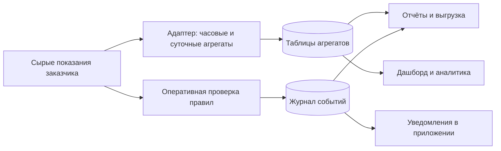

# Уведомления, отчёты, выгрузка и адаптер источников

Функциональное описание для приложения Smart Energy в ветке **`local-develop`**.

Документ описывает, как новые функции должны выглядеть и работать в приложении. **Уведомления, отчёты и выгрузка — предлагаемые функции для реализации. Адаптер источников и агрегаций уже реализован** и описан как отдельная возможность продукта. Создание этого документа не добавляет новые функции в код.

## 1. Размещение в приложении

Сохранить существующие разделы «Дашборд», «Связи», «Аналитика» и «Источники и агрегации». Добавить в основное меню:

| Элемент | Назначение |
| --- | --- |
| **Уведомления** | Журнал превышений мощности, отсутствующих показаний и отклонений напряжения; настройка правил для администратора |
| **Отчёты и выгрузка** | Формирование отчётов за период, скачивание таблиц и история подготовленных файлов |
| **Колокольчик в шапке** | Число непрочитанных уведомлений, краткий список последних событий и переход в журнал |

На дашборде добавить кнопки **«Сформировать отчёт»** и **«Выгрузить данные»**. При переходе они передают выбранные пользователем период, счётчик и остальные фильтры. На карточке счётчика показывать текущие нарушения и время последнего корректного показания.

Новые страницы должны использовать существующие тему, оформление карточек, фильтров и таблиц. На узком экране фильтры складываются в колонку. Ошибка загрузки дашборда не должна мешать открыть журнал уведомлений или историю отчётов.

## 2. Уведомления о состоянии измерений

### 2.1. Что получает пользователь

Система самостоятельно обнаруживает заданные нарушения и показывает понятное сообщение: **что произошло, с каким счётчиком, когда, какое значение получено и какое правило нарушено**. Пользователю не нужно постоянно следить за графиками.

Для первой реализации уведомления доступны внутри приложения. Отправка email, SMS, сообщений в мессенджеры и браузерных push-уведомлений в этот объём не входит.

### 2.2. Виды правил

| Тип | Условие | Что показать |
| --- | --- | --- |
| **Превышение мощности** | Корректная активная мощность выше заданного предела в течение настроенного времени | Счётчик, текущая и максимальная мощность события, порог, начало и длительность превышения |
| **Отсутствие показаний** | От контролируемого счётчика слишком долго не приходят новые показания | Время последнего измерения, время последнего получения данных, продолжительность отсутствия, допустимая задержка |
| **Отклонение напряжения** | Напряжение одной из контролируемых фаз ниже нижней или выше верхней границы в течение настроенного времени | Счётчик, фаза, значение напряжения, допустимый диапазон, начало и длительность отклонения |

Порог мощности задаётся в **кВт**, напряжение — в **В**, длительность — в секундах или минутах. Границы и допустимые задержки настраиваются под объект; приложение не должно выдавать произвольные значения за обязательные нормативы.

Мощность проверять по общей активной мощности. Если её нет, для оперативного контроля допускается сумма трёх корректных фаз; при недостатке нужных значений состояние — «Недостаточно данных». Напряжение проверять **отдельно по фазам**, поскольку среднее значение может скрыть нарушение одной из них. Для источника с единственным каналом напряжения правило настраивается на этот канал.

**Нулевое потребление не означает отсутствие показаний.** Свежая запись с корректной нулевой мощностью подтверждает работу источника. Отдельно различать отсутствие новых строк и поступление строк без корректного значения контролируемого показателя. Во втором случае показывать «Показания поступают, но мощность/напряжение недоступны» и не делать вывод о норме или превышении.

### 2.3. Как выглядит страница «Уведомления»

В верхней части — карточки **«Активные нарушения»**, **«Без показаний»**, **«Непрочитанные»**. Счётчики карточек относятся к выбранным фильтрам; число непрочитанных индивидуально для пользователя.

Ниже — фильтры по периоду, типу события, состоянию, важности и счётчику. При наличии сведений в справочнике доступны фильтры по зданию, этажу и помещению. Отсутствие привязки отображается как «Не указано».

Основная часть — таблица:

| Начало | Тип события | Объект | Значение / условие | Длительность | Состояние |
| --- | --- | --- | --- | --- | --- |
| 17.10.2026 14:32 | Превышение мощности | Счётчик А, помещение 101 | 12,4 кВт при пороге 10 кВт | 3 мин | Активно |
| 17.10.2026 15:10 | Отсутствие показаний | Счётчик Б | Последнее измерение в 15:09 | 1 мин | Активно |
| 17.10.2026 16:20 | Отклонение напряжения | Счётчик В, L2 | 198 В при нижней границе 200 В | 2 мин | Восстановлено |

Значения в примере иллюстративные. Каждая строка открывает карточку события с условием правила, фактами срабатывания, временной шкалой и графиком вокруг нарушения. Кнопка **«Открыть счётчик»** ведёт к данным соответствующего устройства. Если детальные данные уже недоступны, сохранённые факты события остаются видимыми.

Использовать состояния **«Активно»** и **«Восстановлено»**. Отдельно хранить отметки **«Прочитано»** и **«Принято в работу»** с пользователем и временем. Прочтение или принятие в работу не устраняет нарушение. Потеря данных во время превышения не считается восстановлением: последнее состояние сохраняется с отметкой «Текущее состояние неизвестно».

### 2.4. Настройка правил

Вкладка **«Правила»** доступна администратору. Для каждого правила задаются:

- Название, тип и список контролируемых счётчиков. В первой версии — контроль каждого счётчика отдельно; правила для суммарной нагрузки группы требуют отдельного расчёта.
- Порог мощности либо нижняя и верхняя границы напряжения; для напряжения — контролируемые фазы.
- Для отсутствия показаний — ожидаемый интервал и допустимая задержка. Для текущего источника исходный интервал около **5 секунд**, но задержка уведомления задаётся отдельно.
- Минимальная длительность нарушения, время подтверждения восстановления и граница возврата в норму, чтобы исключить постоянные переключения около порога.
- Важность: «Предупреждение» или «Критическое»; включение и выключение правила.

Перед сохранением показывать текст условия: например, **«Уведомлять, если мощность счётчика А превышает 10 кВт непрерывно не менее 60 секунд»**. Недопустимые диапазоны и отрицательные задержки не сохраняются.

Изменение правила фиксируется в истории. Уже возникшее событие сохраняет ту версию условия, по которой оно было обнаружено. Новое правило не создаёт массовые уведомления за всю старую историю.

### 2.5. Как избежать ложных событий

Проверки выполняются фоновым процессом независимо от открытого браузера. Для первой реализации ориентир — проверка каждые **15 секунд**, с настройкой частоты по нагрузке источника. Это период работы проверяющего процесса, а не обещание мгновенного обнаружения.

Правила используют свежие нормализованные показания, а не вчерашние агрегаты. Нарушение подтверждается последовательностью корректных измерений; пропуски не доказывают непрерывное превышение. Для отсутствия показаний нужен явный список контролируемых устройств: счётчик, который совсем не прислал строк, нельзя обнаружить только по текущей выборке данных.

Один продолжающийся эпизод создаёт одно событие. Повторные проверки обновляют его длительность и экстремальные значения, не создавая новую строку каждые 15 секунд. Возврат в норму завершает эпизод; последующее нарушение создаёт новый. Восстановление после перезапуска также не должно дублировать события.

Если недоступна сама БД или канал чтения, показывать общую ошибку мониторинга и неизвестное состояние устройств, а не утверждать, что все счётчики одновременно перестали передавать данные. Запоздавшие записи не считаются свежими только потому, что их недавно загрузили; учитывать время измерения и получения. Для источника без времени получения последняя успешная проверка показывается отдельно и не подменяет время поступления измерения.

## 3. Отчёты и выгрузка

### 3.1. Разница для пользователя

**Отчёт** — оформленный результат за период: показатели, графики, события и выводы о полноте данных. **Выгрузка** — таблица выбранных измерений или агрегатов для самостоятельной обработки.

Страница **«Отчёты и выгрузка»** содержит вкладки **«Сформировать отчёт»**, **«Выгрузить данные»** и **«История»**.

### 3.2. Формирование отчёта

В форме пользователь выбирает период, счётчики, доступные организационные фильтры, детализацию **«По часам» / «По суткам»** и состав отчёта:

- Сводка: энергия, средняя и максимальная мощность, количество счётчиков и доступность данных.
- График мощности и энергии за выбранный период.
- Таблица показателей по счётчикам и список устройств с наибольшей известной энергией.
- Зарегистрированные превышения, отклонения напряжения и отсутствующие показания за период.
- Качество данных: пропуски, неизвестные значения, ограничения расчёта и дата актуальности.

В первой версии форматы отчёта — **PDF** для просмотра и **XLSX** для работы с таблицами. Кнопка **«Сформировать»** создаёт фоновое задание. После готовности доступны предварительный просмотр сводки и кнопка **«Скачать»**.

На первой странице PDF указывать название, период, часовой пояс, выбранные объекты, время формирования и актуальность данных. Далее — сводка, графики, таблицы, события и ограничения. В XLSX использовать листы «Параметры», «Сводка», «По счётчикам», «По времени», «События» и «Качество данных».

Среднюю мощность рассчитывать с учётом полноты исходных данных и метода агрегирования, а не простым усреднением несопоставимых средних. Энергию в отчёте и интерфейсе получать из единого согласованного расчёта. Если заданный разрез недоступен, показать это, не подменяя его другим показателем.

### 3.3. Выгрузка таблиц

Форма выгрузки позволяет выбрать период, счётчики, детализацию, показатели и формат **CSV / XLSX**. По умолчанию выгружаются часовые или суточные агрегаты. Выгрузка сырых строк — отдельное расширение, поскольку объём существенно больше и требуются дополнительные ограничения доступа и нагрузки.

Для каждой строки включить начало интервала, его длительность/детализацию, стабильный идентификатор и отображаемое имя счётчика, доступные показатели с единицами, количество исходных точек и признак отсутствующих значений. Привязки к помещению и зданию добавлять при наличии. Если используется версия профиля, она указывается в параметрах формирования.

CSV сохранять в UTF-8 с BOM для открытия в Excel. Время передавать в ISO 8601 с часовым поясом; даты суточных агрегатов сопровождать общим указанием `Europe/Moscow`. Формат чисел и разделитель явно описать в форме и использовать одинаково во всём файле. Пользовательский текст в CSV/XLSX сохранять как текст, исключая выполнение формул при открытии таблицы.

**Выгрузка охватывает весь выбранный набор данных, а не только страницу таблицы в браузере.** Строки сортируются по времени и счётчику. Для больших наборов действует явный лимит; при его превышении предложить уменьшить период или разбить выгрузку. Молча обрезать результат нельзя.

### 3.4. Пропуски и незавершённые периоды

`NULL` в интерфейсе и PDF означает **«Нет данных»**, в таблицах — пустую ячейку с пояснением и признаком качества. Корректный ноль остаётся числом `0`.

Если хотя бы у одного включённого в отчёт счётчика энергия неизвестна, показывать:

- **«Полное потребление: недостаточно данных»**.
- Отдельно — **«Сумма известной энергии»** и число счётчиков/интервалов, по которым она получена.

Не выдавать сумму доступных значений за полное потребление и не восстанавливать пропущенную энергию пропорциональным умножением. Отсутствие целого ожидаемого интервала или счётчика также считается пропуском, даже если строки с `NULL` в таблице нет.

Для отчётов по агрегатам по умолчанию доступны только завершённые сутки. Если пользователь включает сегодняшний день, явно показывать границу доступных данных и неполноту периода. Текущий ежедневный адаптер не строит агрегаты сегодняшнего дня: для него нельзя обещать актуальный отчёт без отдельного оперативного источника. При отсутствии данных дать понятное сообщение и предложить другой период.

Если журнал мониторинга ещё не работал в выбранном периоде, писать **«Мониторинг за период не выполнялся»**, а не «Нарушений не было». История наблюдений и факт отсутствия нарушений — разные состояния.

### 3.5. История формирования

В истории показывать тип документа, период, фильтры, автора, время создания, состояние и срок доступности файла. Состояния: **«В очереди»**, **«Формируется»**, **«Готово»**, **«Ошибка»**, **«Срок хранения истёк»**. Для готового результата — размер и скачивание; для ошибки — понятная причина и повтор с теми же параметрами.

Закрытие страницы не отменяет задание. Готовый файл сохраняет результат на момент формирования: последующий пересчёт агрегатов не меняет уже скачанный документ. Новое формирование создаёт новую запись истории. Срок хранения файлов задаётся сервером и виден пользователю.

## 4. Адаптер источников и агрегаций — реализованная функция

### 4.1. Назначение и ценность

Адаптер подключает таблицу показаний заказчика к формату Smart Energy без ручного написания нового SQL-пересчёта для каждого названия столбца. Оператор один раз настраивает и проверяет профиль, после чего сервис строит часовые и суточные агрегаты автоматически либо по запросу.

В приложении это отдельный раздел **«Источники и агрегации»** (`/aggregation`), доступный активным пользователям с `is_staff=True`. Он состоит из вкладок **«Источник и соответствия»**, **«Пересчёт»**, **«Расписание и история»** и общего журнала заданий.

### 4.2. Подключение и унификация таблицы

Оператор выбирает заранее настроенное серверное подключение и таблицу, затем нажимает **«Обследовать источник»**. Сервис получает названия, типы и комментарии столбцов, небольшую выборку строк и предлагает соответствия полям приложения.

Примеры: `measured_at` → время измерения, `meter_id` → идентификатор счётчика, `active_power` → общая активная мощность, `voltage_l1` → напряжение L1.

Предложения строятся по известным названиям и синонимам. Это не произвольное распознавание смысла данных: при неоднозначности оператор выбирает столбец вручную. Кнопка **«Применить предложения»** заполняет форму, но ещё не запускает запись и не активирует профиль.

Оператор проверяет соответствия, единицы измерения, исходный часовой пояс и интервал. Множитель переводит значения в единицы приложения: например, мощность в кВт умножается на `1000` для получения Вт; для уже заданной в Вт мощности нужен `1`. Необязательные показатели могут отсутствовать и сохраняются как `NULL`.

Связь исходных идентификаторов с существующими именами приложения задаётся картой соответствий. Сервис проверяет имена по справочнику; автоматически создавать помещения, здания и справочники заказчика он не умеет. При необходимости справочник читается через отдельное подключение с нужными правами.

### 4.3. Версии, проверка и запись

Подтверждённая конфигурация сохраняется как неизменяемая версия профиля. Изменение создаёт новую версию, которую нужно заново проверить. Пароли и строки подключения хранятся на сервере; в интерфейсе выбираются псевдонимы подключений.

На вкладке **«Пересчёт»** оператор задаёт начальную дату включительно и конечную исключительно. Например, `17.10 → 18.10` — одни сутки 17 октября по Москве. Сначала выполняется **предварительный расчёт без записи**, затем, после проверки результата и подтверждения замены, — **«Записать агрегаты»**.

Сервис читает сырые данные, проверяет качество и формирует строки отдельно для каждого счётчика и часа/дня. Поэтому 49 счётчиков за полные сутки могут дать **1176 часовых строк** и **49 суточных строк**. Это количество групп, а не гарантия корректной мощности в каждой группе.

Запись заменяет существующие строки всех счётчиков выбранного дня в двух таблицах одной транзакцией. Другие дни остаются без изменений. Повторный расчёт не добавляет дубликаты. Можно пересчитывать старые периоды после новых; ручной пересчёт не передвигает автоматический прогресс.

### 4.4. Расписание и качество

После успешной проверки оператор активирует профиль и отдельно включает расписание. По умолчанию оно выключено. Основной запуск — ежедневно в **00:00 `Europe/Moscow`** за предыдущие сутки; по умолчанию повтор в **00:15** учитывает запоздавшие данные. После простоя сервис обрабатывает пропущенные завершённые дни. Сегодняшние и будущие сутки исключаются.

Предварительный расчёт и запись проверяют интервалы показаний, дубликаты, идентификаторы, долю корректной мощности и существенное уменьшение числа точек относительно существующих агрегатов. Небезопасная замена блокируется; в журнале остаётся причина.

Если у отдельного счётчика за весь день нет корректной активной мощности, сервис сохраняет доступные другие показатели, а мощность и энергию оставляет `NULL`. Остальные счётчики пересчитываются; задание отображается как **«Готово с предупреждениями»**. Полное потребление при таких пропусках неизвестно. Если мощности нет у всех счётчиков либо имеющихся корректных значений недостаточно по порогу качества, запись блокируется.

В журнале видны период, состояние задания, число исходных точек, количество часовых/суточных строк, ошибки и предупреждения. Закрытие браузера не останавливает обработку. Профили, задания и состояние расписания хранятся в PostgreSQL в схеме **`adapter_control`**, а не локально в браузере.

### 4.5. Границы текущей реализации

Адаптер работает с PostgreSQL и числовыми показаниями мощности. Энергия оценивается по полученным точкам и подтверждённому фиксированному интервалу; для текущего источника используется **5 секунд**. Интегрирование нерегулярных интервалов, чтение накопленного счётчика энергии и восстановление пропусков не реализованы.

Рабочие таблицы агрегатов и справочники должны уже существовать. На один комплект таблиц назначения используется один активный профиль; независимые источники нельзя без дополнительной логики объединять заменой одного и того же дня.

Запись `energy_kwh` адаптером и чтение этого значения приложением — отдельные механизмы. Переключатель **`ENERGY_USE_STORED_ENERGY`** управляет чтением сохранённой энергии; по умолчанию сохранён прежний расчёт приложения из средней мощности. Для новых отчётов нужно согласовать единый источник энергии с дашбордом, указывать метод расчёта и учитывать неизвестные значения. Нельзя незаметно смешивать методы в одном документе.

## 5. Как функции взаимодействуют

Следующая схема показывает предлагаемое взаимодействие. Ветка адаптера уже существует; оперативный мониторинг и подготовка файлов требуют реализации.

Оперативный мониторинг должен использовать те же подтверждённые соответствия полей и единицы, что и адаптер. Доступ к нормализованным свежим показаниям для этого потребуется добавить отдельно. **Существующий суточный адаптер сам по себе не является сервисом оперативных уведомлений.** Пересчёт исторических агрегатов не должен создавать новые текущие тревоги за прошлые дни.

Предупреждение адаптера о качестве данных и событие оперативного мониторинга — разные записи. Их можно связать через счётчик и период, но повторный пересчёт не должен дублировать журнал нарушений.

## 6. Доступ и критерии готовности новых функций

Авторизованный пользователь видит события и формирует документы только по разрешённым ему данным. Проверка доступа выполняется на сервере при запросе и скачивании файла. Администратор с `is_staff=True` управляет правилами мониторинга и адаптером. Если ограничения по отдельным объектам ещё не настроены, их требуется реализовать до выдачи пользователям доступа к разным заказчикам.

Функции считаются готовыми, когда проверены следующие сценарии:

1. Длительное превышение мощности создаёт одно событие; краткий всплеск не проходит настроенную выдержку; восстановление завершает событие.
2. Свежие нулевые измерения не вызывают событие отсутствия показаний. Пропавший контролируемый счётчик обнаруживается, даже если от него нет строк в новой выборке.
3. Отклонение одной фазы обнаруживается независимо от среднего напряжения. Отсутствующий канал не принимается за нулевое напряжение.
4. Сбой подключения показывает недоступность мониторинга и не создаёт ложную массовую аварию устройств. Перезапуск и повторная проверка не дублируют события.
5. Отчёт и выгрузка соответствуют выбранным фильтрам, охватывают весь набор и согласованы с методом расчёта приложения. PDF, XLSX и CSV открываются и содержат единицы и время с понятной зоной.
6. При пропусках полный итог остаётся неизвестным, а сумма известной энергии подписана отдельно. Незавершённый или не наблюдавшийся период явно обозначен.
7. Подготовка файла продолжается после закрытия страницы. Доступ к чужому заданию или файлу без прав запрещён; истёкший файл нельзя скачать по старой ссылке.

Подробное руководство по уже работающему адаптеру: [SOURCES_AND_AGGREGATIONS.md](SOURCES_AND_AGGREGATIONS.md). Первый запуск приложения: [README.md](README.md). Техническая настройка адаптера: [adapter/README.md](adapter/README.md).
