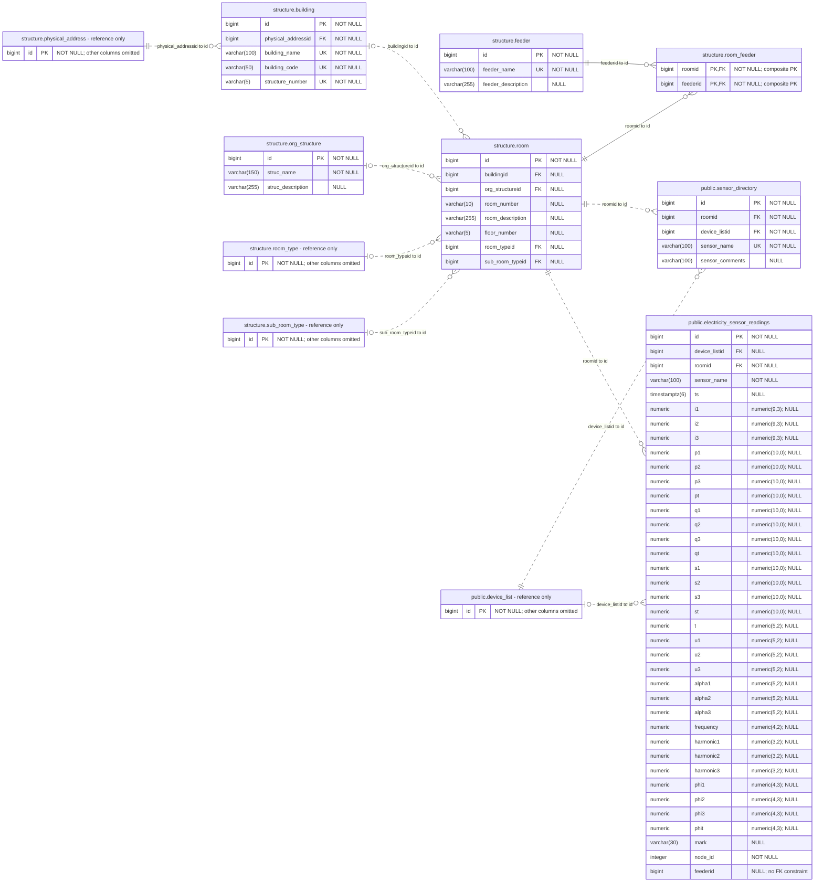
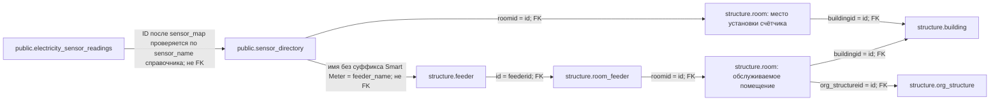

# Модель используемых таблиц БД на .50

Сервер **193.232.208.50**, база **paradigm_db**, PostgreSQL **13.9**.
Снимок каталога: **2026-11-01T17:00:13.638281+00:00**. Структура получена напрямую из PostgreSQL
в read-only транзакции: `pg_class`, `pg_attribute`, `pg_type`, `pg_constraint`
и `pg_index`. Строки показаний и персональные данные для схемы не читались.

Включены семь таблиц, используемых Smart Energy: все **64 столбца**, точные
типы с размерностью, PK/UK/FK и допустимость NULL. Четыре дополнительных
узла показывают только реально проверенный PK `id` внешних справочников —
это пояснение внешних ключей, а не полные модели этих справочников.
Остальные таблицы paradigm_db, старая student на .50 и БД приложения на .42
не входят в этот документ.

## Файлы

- [Полная ER-схема с атрибутами](source50-schema.mmd) — исходник Mermaid.
- [Связи, используемые логикой приложения](source50-application-links.mmd) — отдельный исходник Mermaid.

## Обозначения

- `PK` — первичный ключ; в `room_feeder` два отмеченных поля образуют **один составной PK**.
- `UK` — отдельное уникальное ограничение столбца.
- `FK` — объявленный в PostgreSQL внешний ключ, а не предположение по имени `...id`.
- `NOT NULL`/`NULL` — ограничение столбца; это не результат проверки содержимого строк.
- `||` — ровно один родитель, `|o` — ноль или один, `o{` — ноль или много дочерних записей.
- Сплошная связь `--` означает включение FK в PK дочерней таблицы;
  пунктирная `..` — связь без такого включения. **Обе разновидности в ER-схеме являются реальными FK**.
- В типах использованы эквивалентные сокращения PostgreSQL:
  `varchar(n)` = `character varying(n)`, `timestamptz(6)` = `timestamp(6) with time zone`.
  Для `numeric` исходные точность и масштаб указаны в комментарии атрибута,
  например `numeric(9,3); NULL`: парсер Mermaid 11 не принимает запятую внутри токена типа.

Синтаксис: [официальная документация Mermaid ER](https://mermaid.js.org/syntax/entityRelationshipDiagram.html).

## ER-схема: реальные ограничения БД



## Полный перечень FK выбранных таблиц

| Поле дочерней таблицы | Ссылается на | FK допускает NULL | Ограничение PostgreSQL |
| --- | --- | --- | --- |
| `public.electricity_sensor_readings.device_listid` | `public.device_list.id` | Да | `fk_device_list_electricity_sensor_readings` |
| `public.electricity_sensor_readings.roomid` | `structure.room.id` | Нет | `fk_room_electricity_sensor_readings` |
| `structure.building.physical_addressid` | `structure.physical_address.id` | Нет | `fkbuilding608001` |
| `public.sensor_directory.device_listid` | `public.device_list.id` | Нет | `fk_device_list_sensor_directory` |
| `public.sensor_directory.roomid` | `structure.room.id` | Нет | `fk_room_sensor_directory` |
| `structure.room.org_structureid` | `structure.org_structure.id` | Да | `fkroom229893` |
| `structure.room.buildingid` | `structure.building.id` | Да | `fkroom494567` |
| `structure.room.room_typeid` | `structure.room_type.id` | Да | `fkroom572464` |
| `structure.room.sub_room_typeid` | `structure.sub_room_type.id` | Да | `fkroom676499` |
| `structure.room_feeder.feederid` | `structure.feeder.id` | Нет | `fkroom_feede113916` |
| `structure.room_feeder.roomid` | `structure.room.id` | Нет | `fkroom_feede119736` |

Кардинальности описывают допустимые связи по ограничениям БД, а не количество
фактически заполненных строк. Все перечисленные FK на момент снимка имеют
`convalidated=true`.

## Логика приложения: как находятся счётчики, фидеры и помещения



В этой картинке две роли `structure.room` обозначают одну физическую таблицу:
помещение установки счётчика и помещение, которое обслуживается его фидером.
Их нельзя автоматически считать одним и тем же помещением.

Две связи приложения не объявлены в PostgreSQL как FK:

1. **Показания → справочник счётчиков.** Адаптер читает имена из
   `public.sensor_directory.sensor_name` и проверяет ID показаний по этому
   перечню. Если в профиле задан `sensor_map`, сначала применяется он.
   Это проверка в коде, не SQL JOIN внутри чтения сырья и не ограничение БД.
2. **Счётчик → фидер.** Django получает имя фидера из имени счётчика,
   удаляя завершающий суффикс вместе с пробелами:

   ```sql
   f.feeder_name = regexp_replace(sd.sensor_name::text, '\s+Smart Meter$', '')
   ```

   Это строковое сопоставление. Отсутствие подходящего имени допустимо при
   `LEFT JOIN`; схема БД не гарантирует наличие такого фидера для счётчика.

Код связей: [dashboard_queries.py](../../Бэк/project_backend/apps/consumption/dashboard_queries.py),
функция `_metadata_ctes()`. Проверка ID адаптера:
[service.py](../../adapter/service.py), функция `directory_names()`, и
[runner.py](../../adapter/runner.py), функция `quality_report()`.

## Что важно при чтении схемы

- У `electricity_sensor_readings.sensor_name` нет FK на `sensor_directory.sensor_name`.
  В справочнике это имя уникально, а соответствие показаний проверяет адаптер.
- У `electricity_sensor_readings.feederid` **нет объявленного FK** на `structure.feeder`.
  Нельзя рисовать такую физическую связь только из-за названия столбца.
  Текущий SQL Django определяет фидер по имени счётчика, как показано выше.
- `electricity_sensor_readings.roomid` и `sensor_directory.roomid` действительно
  ссылаются на `structure.room.id`, но ограничения не требуют совпадения
  помещений между записью показания и записью справочника для одного имени.
- `ts` в сырой таблице допускает NULL на уровне БД. Адаптер предъявляет более
  строгое требование: обнаруженный NULL времени блокирует пересчёт.
- Индекс/ограничение уникальности `(sensor_name, ts)` в полученном каталоге
  отсутствует; уникален PK `id`. Проверка повторных времён остаётся задачей адаптера.
- `room_feeder` реализует связь многие-ко-многим между помещениями и фидерами.
  Уникальна пара `(roomid, feederid)`, а не каждый из этих столбцов отдельно.
- В сырой таблице показаны и столбцы, которые текущий профиль адаптера не использует:
  например, `alpha1..3`, `harmonic1..3`, `phi1..3`, `phit`, `mark`, `node_id`.
  Их присутствие в модели не означает, что они участвуют в расчёте дашборда.
